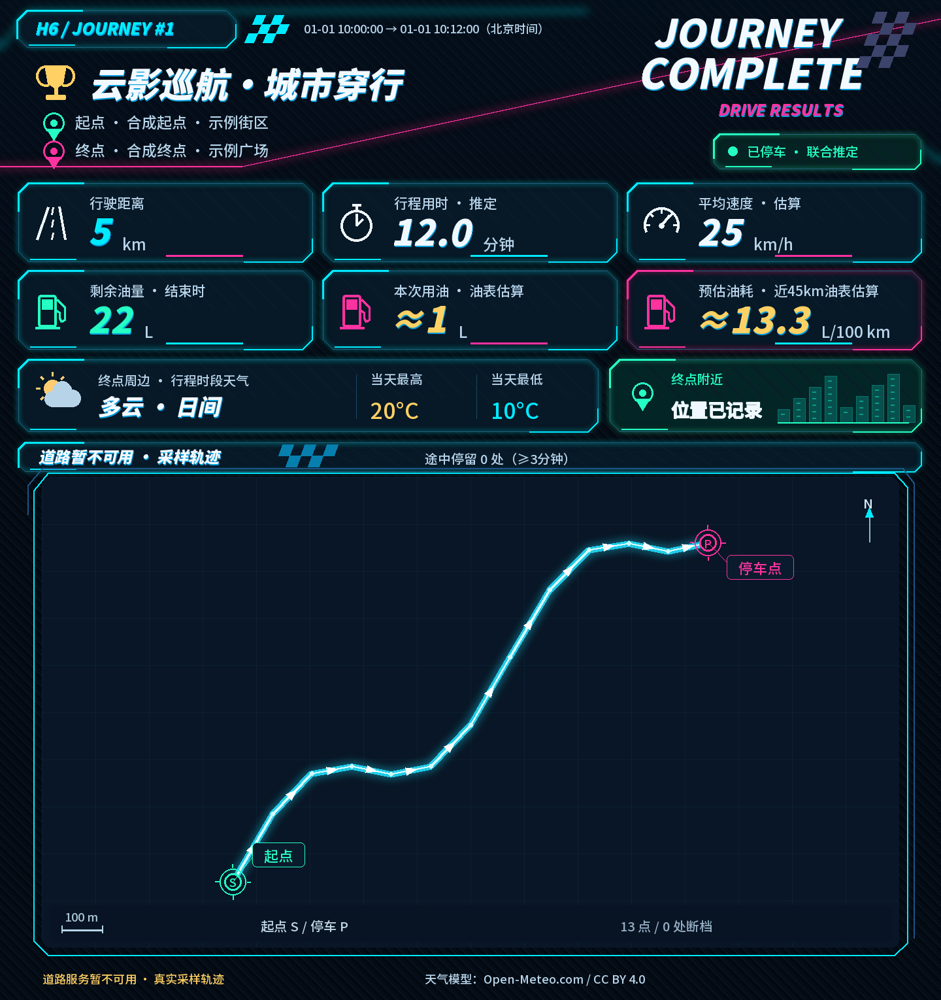

# H6 Trip Recorder · H6 轨迹记录器

在 NAS、迷你主机或本机上记录车辆云端轨迹，将每段行程生成赛车游戏风格的图片，并通过飞书机器人推送。

包含本地 SQLite 记录、行程推定、霓虹结算卡片、腾讯道路底图、天气、途中停留、长途分段、飞书图片队列和状态提醒。车辆数据来自云端，手机无需留在车内。



*样例由合成轨迹生成，不含真实位置、真实道路底图或用户记录。*

## 开源范围

本仓库提供记录器、网页、绘图、数据处理和通知模块，包含完整的离线测试。车辆协议客户端需要单独接入；仓库中没有其协议实现、共享签名材料或 App 文件。未配置车辆客户端时，管理页与离线绘图仍可使用。接入说明见 [车辆客户端](docs/VEHICLE_CLIENT.md)。

## 快速启动

需要 Docker Engine 和 Docker Compose v2。

```sh
git clone https://github.com/apple5089/h6-trip-recorder.git
cd h6-trip-recorder
cp .env.example .env
mkdir -p external/vehicle-client
docker compose up -d --build
```

打开 [本机管理页](http://localhost:18770)。首次启动时没有账号、密钥或历史记录；实时采集前请先接入车辆客户端。完整流程见 [安装与使用说明](docs/USAGE.md)。

默认仅监听本机。通过 NAS 内网访问时，在 `.env` 中同时设置 `BIND_IP` 为 NAS 的内网地址，`PUBLIC_ORIGIN` 为浏览器实际访问的完整地址，然后运行 `docker compose up -d`。管理页没有独立登录认证，请通过受控网络、SSH 隧道或带认证的反向代理访问。

## 配置顺序

1. 按 [接入说明](docs/VEHICLE_CLIENT.md) 提供兼容车辆客户端并重启。
2. 在管理页用本人车辆账号完成短信登录，选择车辆，开启持续记录。
3. 填写飞书应用 App ID、App Secret 和群聊 `chat_id`；应用机器人用于文字和图片，Webhook 用于文字。
4. 填写自己的腾讯 Web 服务 Key、可选 SK，以及可选 Kimi Key。
5. 选择已结束的行程，先预览 PNG，再按需补发。

密钥在本机加密保存，界面不回显。各用户使用自己的账号、API 配额和飞书应用。具体权限和字段见 [使用说明](docs/USAGE.md#飞书推送)。

## 数据口径

| 项目 | 口径 |
| --- | --- |
| 行驶距离 | 有效总里程首尾差，缺失时显示未知 |
| 行程用时、均速 | 首末观测时刻跨度；均速包含中途停留 |
| 本次用油 | 油量表首尾变化；油表未变不代表零耗油 |
| 百公里油耗 | 近期至少 10 km 的油表下降估算，加油后重新积累 |
| 停车、途中停留 | 根据低频云端样本推定；定位断档单独标记 |
| 天气 | 终点附近粗网格、北京时间时段的天气模型结果 |

默认采样间隔 60 秒。长途从 50 km 起按约 5 km 分段，飞书最多发送总览和 3 张精选图。车型、接口字段和原始坐标系应分别验证；本仓库不会将未知枚举当作已确认的门窗状态。

## 本地开发

Python 3.13 或以上：

```sh
python -m venv .venv
# Linux/macOS
source .venv/bin/activate
# Windows PowerShell: .venv\Scripts\Activate.ps1
pip install -r requirements-dev.txt
python -m pytest tests -q
python tools/check_public_tree.py
python tools/render_demo.py
python app.py
```

`python app.py` 默认使用项目下的 `data/`，监听本机 `18770` 端口。终端启动不会自动读取 `.env`；`PUBLIC_ORIGIN`、`DATA_DIR`、`BIND_HOST`、`PORT` 可通过系统环境变量设置。

## 隐私、维护与许可证

- [隐私和外发数据说明](docs/PRIVACY.md)
- [备份、升级与故障处理](docs/USAGE.md#备份与升级)
- [安全报告](SECURITY.md)
- [第三方组件及字体许可](THIRD_PARTY_NOTICES.md)

本仓库原创代码采用 [MIT License](LICENSE)。Leaflet 和字体按各自许可证使用。腾讯、飞书、Kimi、天气和地图服务的账号、配额及服务条款由使用者自行配置和遵守。
